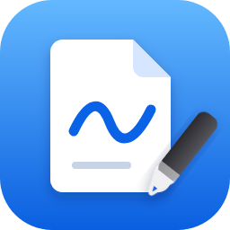
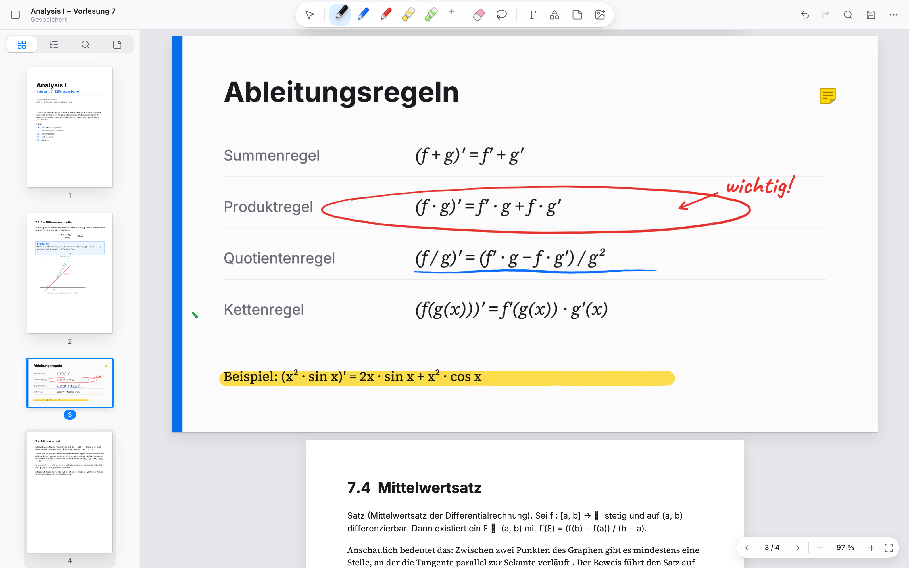

<p align="center">
  
</p>

<h1 align="center">Scribo</h1>
<p align="center"><b>PDFs beschriften wie auf Papier.</b><br/>Der PDF-Editor für handschriftliche Notizen im Studium – für Windows 11 und Stift.</p>

<p align="center">
  <a href="https://github.com/Marco-P-Keller/scribo/releases/latest/download/Scribo-Setup-x64.exe"><b>⬇ Download für Windows</b></a> ·
  <a href="https://marco-p-keller.github.io/scribo/">Webseite</a> ·
  <a href="https://marco-p-keller.github.io/scribo/app/">Im Browser ausprobieren</a>
</p>

<p align="center">
  
</p>

## Download

| Datei | Für wen |
|---|---|
| [`Scribo-Setup-x64.exe`](https://github.com/Marco-P-Keller/scribo/releases/latest/download/Scribo-Setup-x64.exe) | Windows 10/11 (Intel / AMD) – empfohlen |
| [`Scribo-Setup-arm64.exe`](https://github.com/Marco-P-Keller/scribo/releases/latest/download/Scribo-Setup-arm64.exe) | Windows 11 auf ARM (z. B. Snapdragon-Geräte) |
| [`Scribo-Portable-x64.exe`](https://github.com/Marco-P-Keller/scribo/releases/latest/download/Scribo-Portable-x64.exe) | ohne Installation (kein Auto-Update) |

Die Installation braucht keine Administratorrechte, Updates kommen automatisch von GitHub.

> **Hinweis zu SmartScreen:** Scribo ist noch nicht code-signiert. Beim ersten Start zeigt Windows „Der Computer wurde durch Windows geschützt“. Klicke auf **Weitere Informationen → Trotzdem ausführen**.

## Funktionen

- **Tinte** mit runden Strichenden und einstellbarer **Glättung** (schwach bis stark); der Strich erscheint live unter der Stiftspitze. Gleichmäßig breit wie ein Fineliner oder, wenn eingeschaltet, **druckempfindlich** mit einstellbarer Stärke und Empfindlichkeit (bis Füllfeder)
- **Stift & Textmarker** mit Farbe, Stärke und Deckkraft, als **Favoriten-Leiste** (Ziehen zum Umsortieren)
- **Automatische Formerkennung**: Kreis, Ellipse, Rechteck, Dreieck, Linie – nach kurzem Ruhen des Stifts („Halten“) oder sofort beim Absetzen („Auto“)
- **Stifttasten**: Taste 1 (Radiertaste, Code 32) radiert ganze Linien, Taste 2 (Seitentaste, Code 2) öffnet das Lasso; frei belegbar, mit Live-Test unter *Einstellungen*, in dem die gedrückte Taste aufleuchtet
- **Lasso & Auswahl**: Handschrift auswählen, kopieren, ausschneiden, verschieben, skalieren, drehen, umfärben; eine per Stifttaste gezogene Auswahl lässt sich direkt mit der Stiftspitze verschieben und transformieren
- **Radierer** (Linie oder Punkt), unbegrenzt **Rückgängig / Wiederholen**
- **Formen** (Linie, Pfeil, Rechteck, Ellipse, Polygon, Linienzug) mit Füllung und Strichart, **Text** (4 Schriften), **Haftnotizen** (echte PDF-Kommentare), **Bilder**
- **Textmarker auf PDF-Text**: Text markieren → hervorheben, unterstreichen, durchstreichen
- **Neues Notizbuch** auf leerem Papier, Notizpapier (liniert, 8 mm), Blockpapier (kariert, 5 mm) oder Punktraster, in A3, A4, A5, A6 oder Letter, hoch oder quer
- **Seiten**: „Seite hinzufügen“ unter der letzten Seite oder Seite einfügen, jeweils mit Wahl von Papier, Grösse (auch „wie die Seite davor“) und Ausrichtung; drehen, sortieren, duplizieren, löschen
- **Tabs**: mehrere PDFs im selben Fenster, jedes mit eigener Ansicht; Strg+Tab wechselt, Strg+W schließt, Tabs per Ziehen sortieren. PDFs aus dem Explorer öffnen als neuer Tab
- **Suche**, Gliederung, Miniaturen, Notizen-Übersicht, Drucken, Hell/Dunkel
- **Touch**: Scrollen, Pinch-Zoom, Handballen-Erkennung

### Speichern wie in klassischen PDF-Editoren

`Strg + S` schreibt direkt in dieselbe Datei (atomar, mit Schutz gegen fremde Änderungen). Die Anmerkungen stehen danach **in der PDF** und sind in jedem PDF-Programm sichtbar. Gleichzeitig legt Scribo die editierbaren Striche als eingebettete Datei (`scribo-notes.json`) ab, sodass sie beim nächsten Öffnen wieder voll bearbeitbar sind. Die sichtbare Ebene heißt „Scribo Notizen“ und lässt sich in anderen Programmen ein- und ausblenden. *Datei → Flache Kopie exportieren* erzeugt eine PDF ohne editierbare Daten.

### Bekannte Grenzen

- Ausfüllbare PDF-Formulare werden angezeigt, lassen sich aber (noch) nicht ausfüllen.
- Passwortgeschützte PDFs lassen sich öffnen und lesen, Anmerkungen können darin aber nicht gespeichert werden.
- Digital signierte PDFs verlieren beim Speichern die Gültigkeit der Signatur (die PDF wird neu geschrieben). Nutze dafür *Speichern unter*.
- Die Windows-Version ist noch nicht code-signiert (SmartScreen-Hinweis, siehe oben).

## Tastenkürzel

`Strg+O` Öffnen · `Strg+S` Speichern · `Strg+Umschalt+S` Speichern unter · `Strg+Z / Y` Rückgängig / Wiederholen · `Strg+C / X / V / D` Kopieren / Ausschneiden / Einfügen / Duplizieren · `Entf` Löschen · `Strg+F` Suchen · `Strg+B` Seitenleiste · `Strg+0 / 1 / 2` Breite / 100 % / Ganze Seite · `Leertaste` Verschieben · `V P H E L T S N` Werkzeuge · `Strg+/` alle Kürzel

## Datenschutz

Scribo läuft vollständig offline. Es gibt keine Konten, keine Telemetrie und keine Netzwerkzugriffe außer der Update-Prüfung gegen GitHub Releases in der installierten Version.

## Entwicklung

```bash
npm install
npm run dev          # Browser-Version mit Hot Reload (http://localhost:5173)
npm start            # Electron-App aus dem Build
npm run typecheck && npm test
npm run test:e2e     # echter Electron-Test: öffnen, schreiben, Strg+S, neu öffnen
npm run dist         # Windows-Installer in ./release (am besten unter Windows)
```

Releases entstehen automatisch: `git tag v1.0.1 && git push --tags` baut die Installer in GitHub Actions und hängt sie an das Release.

Technik: Electron · TypeScript · [PDF.js](https://mozilla.github.io/pdf.js/) (Anzeige) · [pdf-lib](https://pdf-lib.js.org/) (Speichern, in einem Web Worker) · [perfect-freehand](https://github.com/steveruizok/perfect-freehand) (Tintenform). Details zu den Lizenzen: [THIRD_PARTY_NOTICES.md](THIRD_PARTY_NOTICES.md).

## English

Scribo is a PDF editor for handwritten study notes on Windows 11 with a pen: pressure-sensitive ink, automatic shape recognition, pen-button erase/lasso, favourites bar, lasso transform, text/shapes/notes, page management, several PDFs as tabs in one window, and `Ctrl+S` saving straight into the same PDF (annotations stay visible in every viewer and editable in Scribo). Free and open source (MIT). Download the installer from the [latest release](https://github.com/Marco-P-Keller/scribo/releases/latest) or try the [browser version](https://marco-p-keller.github.io/scribo/app/).

## Lizenz

[MIT](LICENSE) © 2026 Marco Keller
